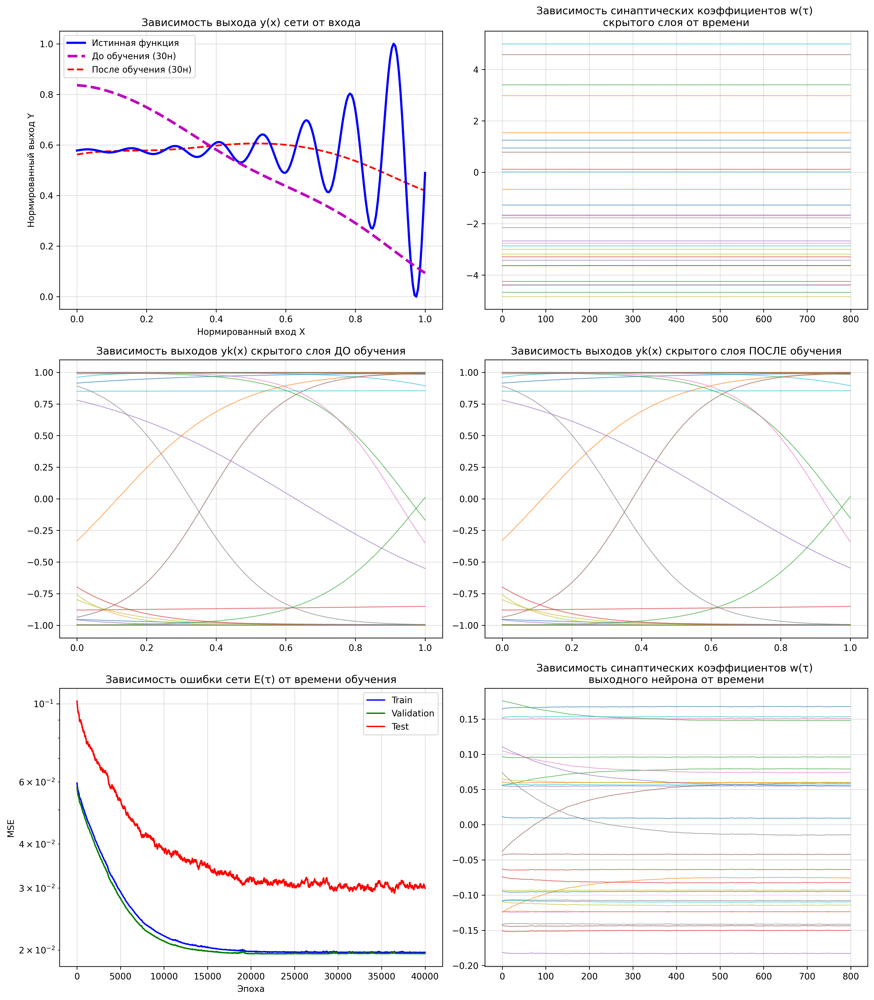

# 🧠 NeuralFunctionApproximation

Эксперименты с аппроксимацией нелинейных функций небольшими полносвязными нейросетями на PyTorch.


## Что исследуется

- Сеть с 30 скрытыми нейронами, Tanh и стохастическим SGD для `sin(5x) · exp(x/2)` на `[-5, 5]`.
- Отдельный эксперимент с 5 нейронами и Adam для `sin(3x)` на `[0, 2π]`.
- Min-Max-нормализация и разделение данных примерно в пропорции 60/30/10.
- Кривые ошибок, выходы скрытых нейронов и изменение весов.
- Максимальная абсолютная ошибка, стандартное отклонение ошибки и RMSE.

## Пример результата



Изображение сохранено из исходного проекта; это иллюстрация прежнего запуска, а не обещание качества или результат новой проверки.

## Запуск

Рекомендуется Python 3.11 или 3.12 в отдельном окружении:

```bash
python3 -m venv .venv
source .venv/bin/activate
python -m pip install -r requirements.txt
mkdir -p runs
cd runs
python ../src/train_30_neurons.py
```

В Windows активируйте окружение командой `.venv\Scriptsctivate`. Основной эксперимент выполняет 40 000 шагов и сохраняет `plots_stage2_30neurons_FINAL.png` в текущую рабочую папку. Для запуска без графического окна в macOS/Linux:

```bash
MPLBACKEND=Agg python ../src/train_30_neurons.py
```

Более короткий эксперимент:

```bash
python ../src/train_5_neurons.py
```

## Структура и ограничения

- `src/train_30_neurons.py` — основной эксперимент.
- `src/train_5_neurons.py` — отдельная функция, архитектура и оптимизатор.
- `src/plot_function.py` — визуализация функции.
- `docs/training-example.png` — сохранённая иллюстрация.

Два эксперимента используют разные функции, поэтому их результаты нельзя считать контролируемым сравнением числа нейронов. Метрики рассчитаны на нормированных данных. Seed фиксирован, но версии библиотек и платформа могут влиять на воспроизводимость. Модели в файл не сохраняются; основной скрипт в конце восстанавливает начальные веса для иллюстрации состояния до обучения. GPU не требуется.

## Проверка подготовки — 12 октября 2026

На macOS (Apple Silicon), Python 3.12, выполнены оба эксперимента без графического окна: 40 000 шагов для 30 нейронов и 1 000 шагов для 5 нейронов. Графики созданы. Версии использованного окружения сохранены в `requirements-tested.txt`; установить их можно через `python -m pip install -r requirements-tested.txt`. Это проверка воспроизводимого запуска, а не гарантия точности аппроксимации.
